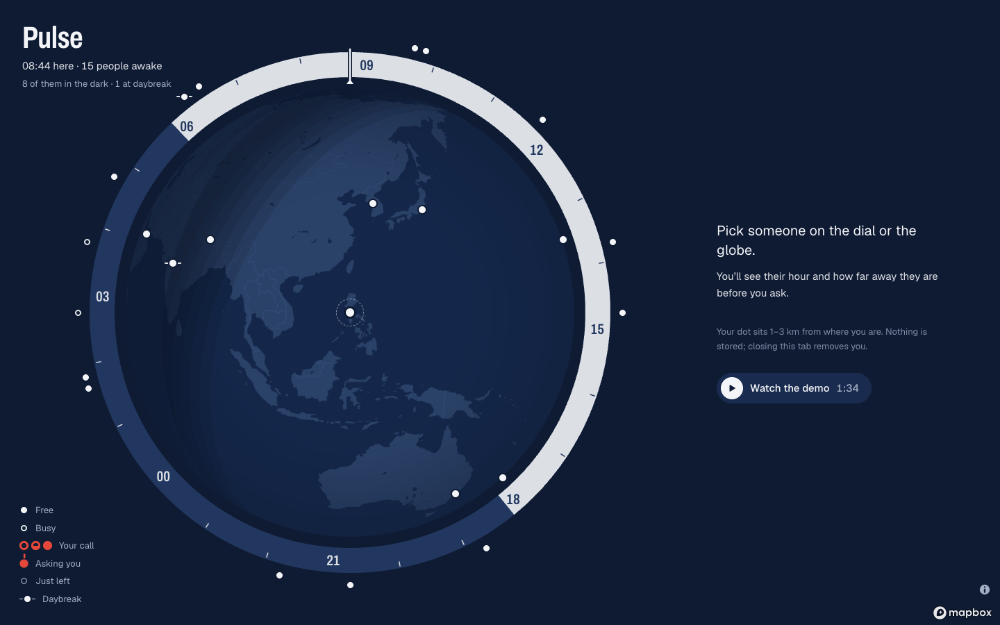
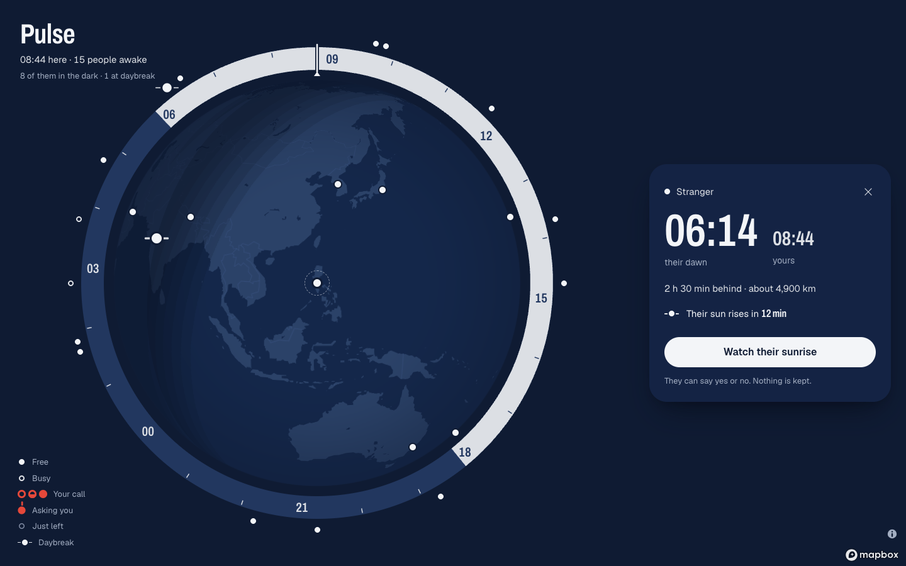
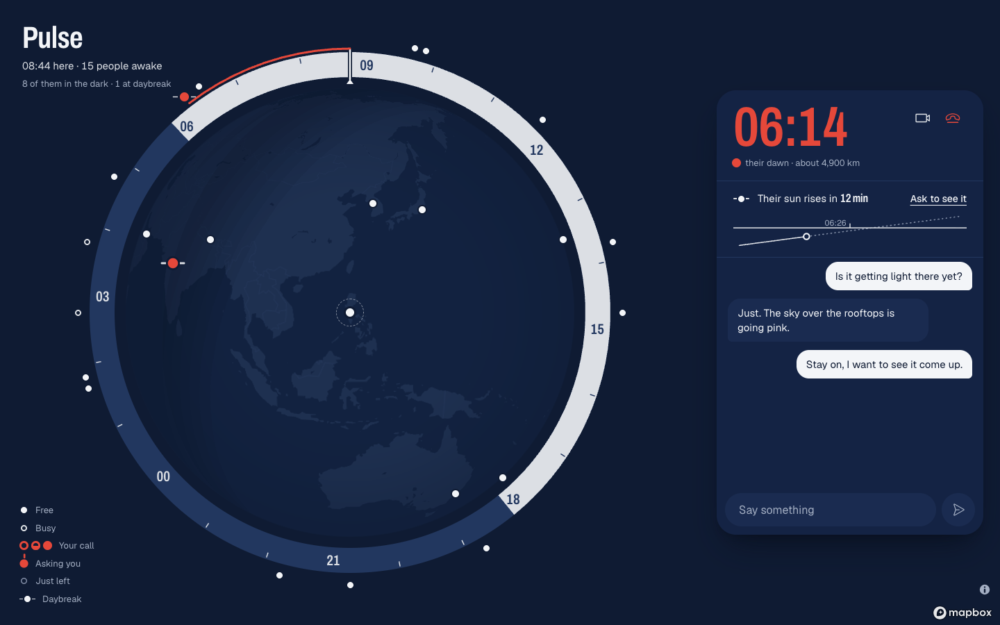
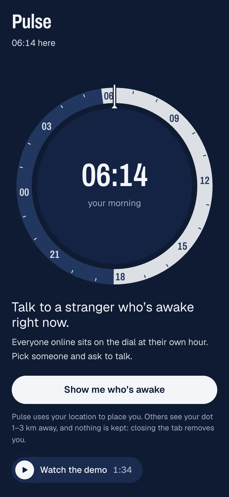
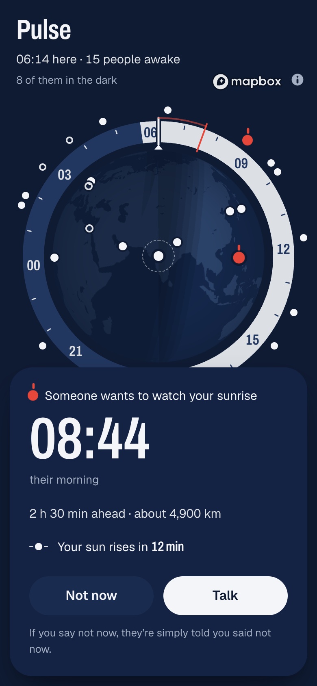
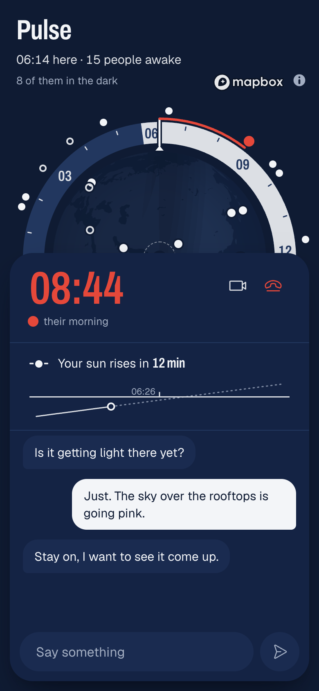

# Pulse

Talk to a stranger who's awake right now. Everyone online sits on a world-time dial
at their own hour. Pick someone, ask, then talk or video-call peer to peer. There are
no accounts, and nothing is stored.

This repository is **my build of the Pulse take-home assessment**, covering all four
phases.

- **Live app (my deployment):** https://pulse-technical-assessment-alpha.vercel.app
- **Source (my repository):** https://github.com/edillormark2/Pulse-Technical-Assessment
- **Demo video (1:34):** [watch the walkthrough](https://pulse-technical-assessment-alpha.vercel.app/demo/pulse-demo-v1.mp4),
  also on the app's entry screen
- **Write-up:** [NOTES.md](NOTES.md), one section per phase, and [DESIGN.md](DESIGN.md),
  the design system

> **The original app is a separate deployment.** This repository was cloned from the
> assessment's starting point, which is deployed at https://pulse-silk-eta.vercel.app/
> and does not include any of my changes. Its brief is kept at the bottom of this page,
> under [The original assessment brief](#the-original-assessment-brief).



## What I built

### Phase 1 — Make it run

The app didn't work end to end. I reproduced and fixed 14 bugs. They included dots
that stayed on the map long after people left, peers that never connected, chat that
never arrived, calls stuck on "Connecting…", a camera left on after hanging up, and
people stuck at the location step.
[Details in NOTES](NOTES.md#phase-1--make-it-run).

### Phase 2 — Make it good: World Time

Pulse is about who is awake right now, so the interface became a **world-time dial**.
The globe sits inside a 24-hour day/night bezel, your hour is fixed at the top, and
everyone online is marked at their own hour.

- **One set of marks** for every state, the same on the dial, the globe and every card.
- **Red only for the live connection.**
- **Waits you can watch:** a sweep hand and named steps, never a spinner.
- **Phones are first-class**, and the dial doubles as the keyboard and screen-reader
  list.

[Details in NOTES](NOTES.md#phase-2--make-it-good) · [DESIGN.md](DESIGN.md).

### Phase 3 — Make it secure

A ranked review of the API, then fixes:

- secret session tokens (before, anyone could act as anyone);
- call state kept on the server;
- rate limits in Postgres;
- a nonce-based CSP and security headers;
- caps on input size;
- the location offset applied on the device.

`npm run test:security` sends 42 attacks to a local server, and all are refused.
[Details in NOTES](NOTES.md#phase-3--make-it-secure).

### Phase 4 — Make it better: Daybreak

Somewhere on Earth the sun is always a few minutes from rising. **Daybreak** marks the
strangers whose sunrise is under half an hour away, and lets you watch it come up with
them on a call. Their card counts down to the minute, and on the call a sky strip shows
the sun reaching their horizon at the second it rises. Sunrise is computed from the
real sun, so no API is needed.
[Details in NOTES](NOTES.md#phase-4--make-it-better-daybreak).

## Screenshots

<table>
  <tr>
    <td width="50%"></td>
    <td width="50%"></td>
  </tr>
  <tr>
    <td>Daybreak: their sun rises in 12 minutes, so the one action is "Watch their sunrise".</td>
    <td>On the call, the sky strip counts down while the sun climbs toward their horizon.</td>
  </tr>
</table>

<table>
  <tr>
    <td width="33%"></td>
    <td width="33%"></td>
    <td width="33%"></td>
  </tr>
  <tr>
    <td>Arriving on a phone: your hour inside the ring.</td>
    <td>Being asked: "Someone wants to watch your sunrise".</td>
    <td>The same call on their phone.</td>
  </tr>
</table>

The screenshots come from a production build running locally, with test users placed
in real cities and one placed where the sun was about to rise.

## Run it locally

1. Install dependencies: `npm install`
2. Copy `.env.example` to `.env`, then set `DATABASE_URL` (Postgres) and
   `NEXT_PUBLIC_MAPBOX_TOKEN`.
3. Create the tables: `npx prisma migrate deploy`
4. Start the app: `npm run dev`, then open http://localhost:3000 in two browser
   windows (see [Testing with two users](#testing-with-two-users)).

To check it, run `npm test` for the unit tests, or `npm run test:security` for the
API attacks (the app must be running locally).

---

## The original assessment brief

*This is the brief as it was given, with its headings nested here. Its live link is
labelled as the original app, which is not my build.*

Welcome, and thanks for taking the time. **Pulse** is a working (mostly!) Next.js
app: a living globe of anonymous strangers — every online user is a dot on a world
map; tap one to connect for text chat or a video call. No accounts, no history,
nothing stored. Coordination and WebRTC signaling run through the server
(Postgres + HTTP polling); chat and video are peer-to-peer over WebRTC.

You'll work through **four phases**. They're designed to be realistic, not trick
questions. We care as much about *how you think* as about what you ship — so a
short write-up is required (see **Deliverables**).

> **Using AI is allowed.** Use whatever tools you'd use on the job. The phases are
> built so that judgment, debugging, and product taste matter more than raw code
> generation. Please make the decisions yours and be ready to explain them.

---

### See it live (the original app)

The original version, before my changes, is deployed at
**https://pulse-silk-eta.vercel.app/**. My build is at
**https://pulse-technical-assessment-alpha.vercel.app**.

Because Pulse connects two strangers, you need **two participants** to try it: open
the link in **two separate browser windows** (e.g. a normal window + an
incognito/private window, or two different browsers). In each window's DevTools →
**Sensors**, set a different mock geolocation so the two dots land apart, then tap
one dot to connect, accept, chat, and start video.

---

### How it works

- **Coordination only** runs on the server: live presence and the WebRTC signaling
  handshake, stored transiently in **Postgres** (via Prisma) and delivered by short
  **HTTP polling** (no WebSockets — they don't work on Vercel serverless).
- **Chat and video are peer-to-peer** over **WebRTC** (data channel + media). They
  never touch the server, so messages and video are never seen or stored.
- The map is **Mapbox GL JS**. Each dot is placed 1–3 km from the user's real
  location, randomized fresh every session.

---

### Getting started

> #### ⚠️ Repository setup — please read this first
> **Clone this repository — do _NOT_ fork it.** Then create a brand-new **public**
> GitHub repository of your own and push your clone there. **Commit as you go** —
> we review your **git history and commit practice**, so use meaningful,
> incremental commits with clear messages (not one giant final commit). Your final
> deliverables are **your public repo URL** and a **live Vercel URL** — see
> **Deliverables** below.

#### Local setup

1. Install deps:
   ```bash
   npm install
   ```
2. Copy `.env.example` to `.env` and fill in your own credentials:
   - A free Postgres database — [Neon](https://neon.tech) or Vercel Postgres.
   - A free [Mapbox token](https://account.mapbox.com/access-tokens/).
3. Create the tables:
   ```bash
   npx prisma db push
   ```
4. Run it:
   ```bash
   npm run dev
   ```
   Open http://localhost:3000.

#### Testing with two users

WebRTC needs two participants. Open the app in two browser profiles (e.g. a normal
window + an incognito window). In each tab's DevTools → **Sensors**, set a
different mock geolocation so the dots land apart, then connect.

> Connections use **STUN only** (no TURN), so a minority of strict/corporate
> networks won't establish a media connection — that's a known limitation, not
> something you need to solve.

> There is a note in `AGENTS.md` about this codebase. Please read it.

---

### The phases

(See the email for time expectations.)

#### Phase 1 — Make it run
The app does not currently work end-to-end. There are several bugs in here — find
and fix each one until two users can reliably see each other on the map, connect,
chat, and start a video call.

As **one example** of the kind of thing you'll run into:

> "I tested with a friend. After we both closed the app, our dots stayed on the
> map for ages — it kept looking like people were online when nobody was."

That's one bug. **There are more** — this is just an example to show the flavor.
Track down and fix each issue you find.

#### Phase 2 — Make it good
This phase is all about **UI/UX**. Make Pulse genuinely *beautiful* — something
you'd be proud to show off and that people would actually want to use. There's no
mockup and no rules: restyle anything, add motion and polish, rethink the layout,
tighten the flow, sweat the details. **Use your creativity and make this app
gorgeous.** We're looking at your sense of design, taste, and product feel — go
make it stunning.

#### Phase 3 — Make it secure
Review the API before shipping. Identify the issues you'd want fixed before this
went live, prioritize them, and address what you can.

#### Phase 4 — Make it better
Build something **new** that makes Pulse feel more **alive** and/or **safe** — and
that genuinely impresses us. Add a unique feature or capability of your own design:
something creative and original that makes the app stand out and that you'd want a
reviewer to remember. There's no spec and no right answer — the idea is entirely
yours. Surprise us, ship it working, and explain your thinking in your notes.

---

### A note on sequencing

Phases **2 and 4** can be attempted at any time. Phase **3** (security review)
assumes a running app, so it's most natural after Phase 1.

---

### Deliverables

1. **A public GitHub repository.** **Clone** this project (do **not** fork it) and
   push it to a brand-new public repo of your own. Commit as you go — we review
   your **git history and commit practice**, so meaningful, incremental commits
   with clear messages matter.
2. **A live Vercel deployment.** Deploy your finished app and include the URL so we
   can test it end-to-end. Set the same env vars from `.env.example` in the Vercel
   project settings, and run the Prisma schema against your database.
3. **A `NOTES.md`** at the repo root with a short section per phase:
   - **Phase 1:** what was broken, how you found it, how you fixed it.
   - **Phase 2:** what you changed and the thinking behind it.
   - **Phase 3:** the issues you found, how you'd rank them, and what you fixed.
   - **Phase 4:** what you built, why, and what you'd do next with more time.

Submit the **repo URL** and the **Vercel URL**. Keep `NOTES.md` concise — bullet
points are fine. We read it closely.

---

### Ground rules

- Use any libraries, tools, or AI assistance you like.
- Don't worry about pixel-perfect polish or 100% completeness — we're looking at
  judgment, problem-solving, and how you make trade-offs.
- If something is ambiguous, make a reasonable call and note your assumption.
- Do optimization you want, its your decision to make.

Good luck — have fun with it.

---

### How it's scored

| Phase | Weight |
|-------|--------|
| Phase 1 — Make it run | 15% |
| Phase 2 — Make it good | 30% |
| Phase 3 — Make it secure | 20% |
| Phase 4 — Make it better | 30% |
| Engineering practice & delivery | 5% |
